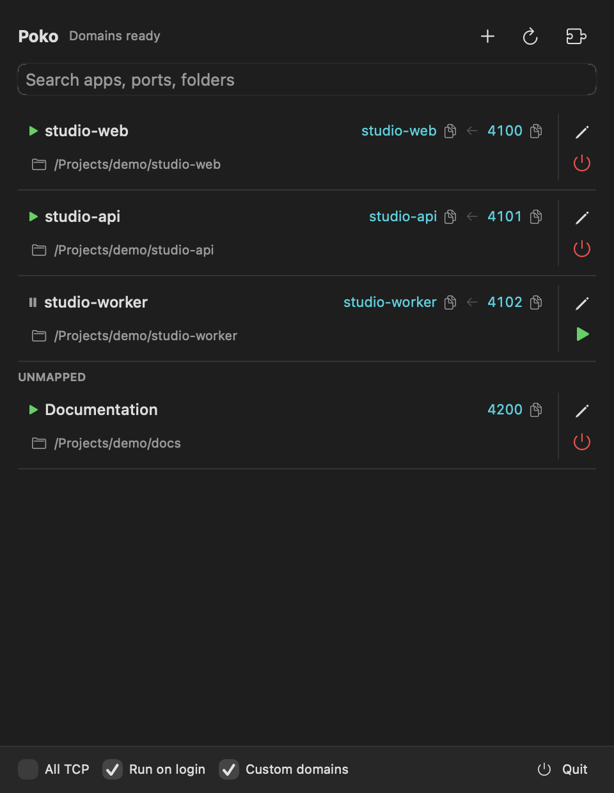
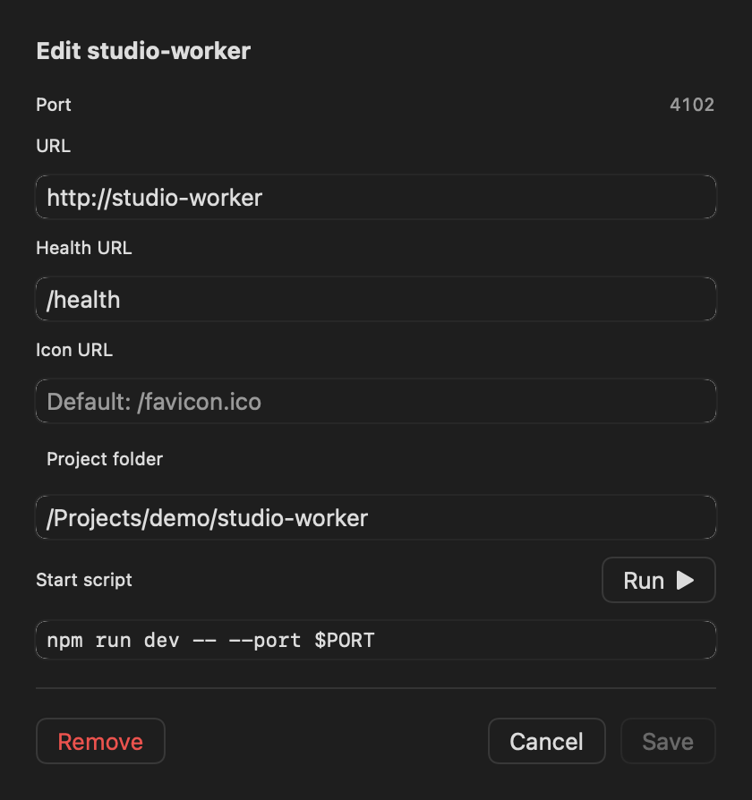
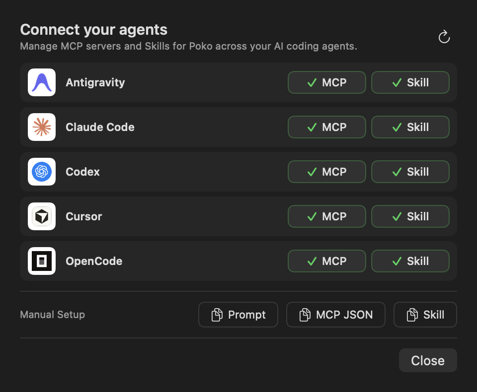
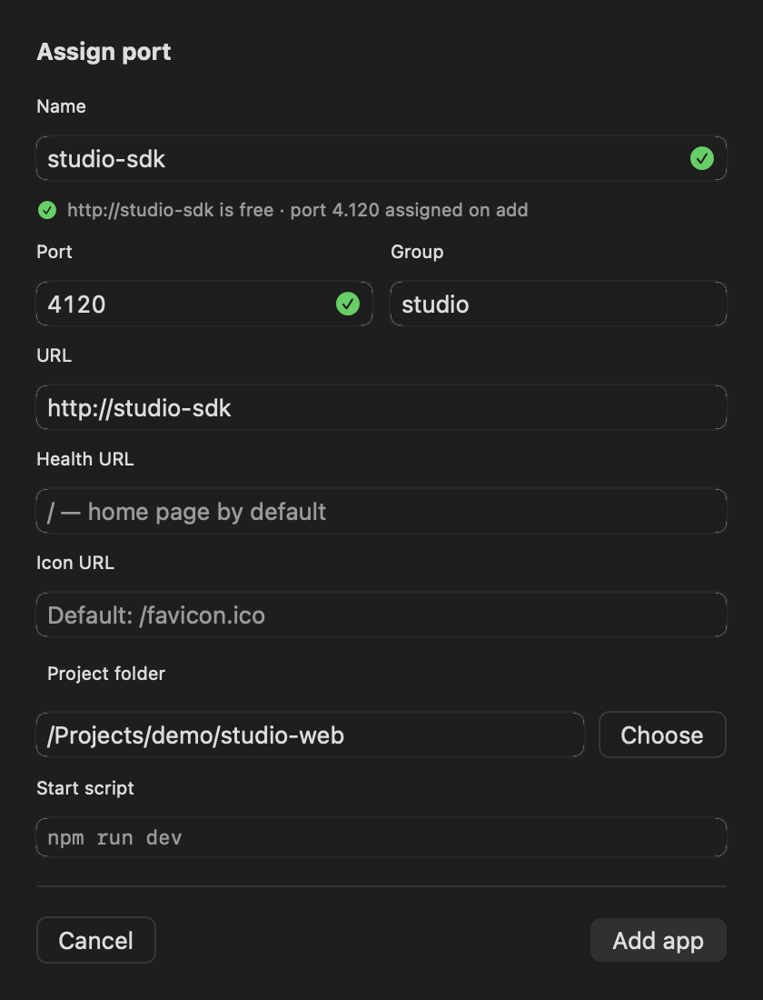

# Poko

**Port control for macOS. Your local apps, one menu bar away.**

Poko gives local development services a stable place to live. Reserve a port, give an app a readable URL, check its health, and start or stop it from a native macOS menu-bar panel. AI coding agents use the same registry through MCP, so your terminal, your agent, and your menu bar agree about which app owns which port.

Working on a frontend, an API, and a docs site? Group them together, give them nearby ports, and open `http://studio-web` instead of remembering another number. Already running a server? Import it without restarting it or changing its port.

Poko runs locally. No account, cloud service, telemetry, or subscription is required.

## What you get

| Feature | How it helps |
| --- | --- |
| Native menu-bar panel | Search apps, ports, and folders; open or copy URLs and ports |
| Shared port allocation | Reserve available ports; reuse a reservation for the same name and folder |
| Project groups | Related services receive nearby ports in blocks of 20, starting at 4100 |
| Local app domains | Optional plain HTTP names such as `http://studio-web` |
| Listener discovery | See existing web services; enable **All TCP** to include other listeners |
| App settings | Set the URL, health endpoint, icon, project folder, and start script |
| Start and stop | Run a saved script, test a draft, or send SIGTERM to a verified listener |
| MCP integration | Connect Codex, Claude Code, Cursor, and OpenCode to the same app controls |

There are two apps: **Poko** is the interface; **Poko Server** manages allocation, discovery, health checks, and routing. The background server starts at login. Quitting the panel leaves it and your development services running.

## Install

Requires **macOS 13 or newer**. Choose the archive for your Mac: `arm64` for Apple Silicon or `x86_64` for Intel.

**One-line install** (downloads the latest release for your Mac, verifies its SHA-256, installs per-user):

```sh
curl -fsSL https://raw.githubusercontent.com/faaydemir/poko/main/install.sh | bash
```

**Or manually:**

1. Download the ZIP for your Mac and its `.sha256` file from [Releases](https://github.com/faaydemir/poko/releases). Optionally verify with `shasum -a 256 -c <archive-name>.sha256`.
2. Extract the ZIP, open **Poko Installer.app**, and choose **Install**.
3. Open **Poko** from your user Applications folder. Click the menu-bar icon to see your apps.

The installer includes Node and the backend dependencies. You do not need Node, npm, or the source checkout to run Poko. Your own app's start script still needs its development tools, such as npm, Python, or a project-specific runtime.

Current archives are **ad-hoc signed, not Apple-notarized**. macOS may block a downloaded installer; for a build you trust, use **System Settings → Privacy & Security → Open Anyway**. Public Developer ID signing and notarization are not configured in this repository.

Installation is per-user and preserves existing mappings. It does not automatically edit your agent configurations or enable system domains. Those are separate actions in the panel. The optional domain helper currently uses `/usr/bin/python3`, which may require Apple's Command Line Tools on a fresh Mac.

### Upgrading from Port

Poko is the new app name. The existing `port` MCP configuration key, `dev.port.*` service identifiers, `PORT_*` environment variables, and Application Support folder are intentionally retained for compatibility. Existing registry data stays usable. Close the old Port UI and open Poko after upgrading. Reconnect agents from **Agents → Add MCP** if their Node executable changed; the connector refuses to overwrite a different existing registration, so remove only that stale `port` entry first.

## First app, in a minute

1. Click **+**. Enter a unique name such as `studio-web`, choose its absolute project folder, and optionally set the group to `studio`.
2. Poko reserves an available port and accepts the mapping. Open **Edit** and set a start script, for example `npm run dev -- --port $PORT`.
3. **Save**, then use the green start action. Your script runs in the project folder with the allocated `PORT` environment variable.
4. Click the port to open the direct localhost address. Enable domains if you also want the short app URL.

Use your framework's port flag if it does not read `PORT`. Some development servers also require allowing the app hostname. Poko does not rewrite project configuration or force other processes to respect a reservation before your app binds.

### Existing services

The **Unmapped** section shows discovered web services. Choose **Edit**, review the suggested URL and folder, and save. This imports the exact current port and PID, plus the settings you entered. Process discovery depends on macOS permissions; missing identity is shown as unavailable.

### Edit, run, remove

| Control | Behavior |
| --- | --- |
| URL | Plain local HTTP hostname, optionally with a path; no explicit port or credentials |
| Health URL | `/` by default; a local path or an HTTP URL for the app or its own localhost port |
| Icon URL | HTTP(S) image URL; empty uses the app's `/favicon.ico` |
| Project folder | Existing absolute directory used as the script working directory |
| Start script | Runs as your user through `/bin/zsh -lc`, with `PORT` assigned |
| Run in the editor | Tests the draft script and folder without saving them; map an imported listener first |
| Save | Persists changed settings |
| Activate | Accepts a reserved mapping |
| Remove | Deletes the mapping and reservation; leaves the process running |
| Shut down | Rechecks the port/PID, then sends SIGTERM; every port owned by that process stops |

Health checks use HTTP GET. Status 200–399 is healthy, other HTTP responses are unhealthy, and connection failures are unreachable. Checks target loopback and do not follow external redirects. Start refuses occupied ports. Shutdown never escalates to SIGKILL and refuses Poko's own services.

Script output is appended to a per-app log in the private application support directory. `start_app` returns the log path and launch PID; a successful launch does not guarantee that the app subsequently becomes healthy.

## Local domains

Click **Enable…** in the panel and approve macOS administrator authorization to enable short names such as `http://studio-web`. A local helper maintains a marked hosts-file block and forwards loopback port 80 to Poko's internal proxy. New mappings and removals update that block automatically. While domains are off, clicking a short app link in the panel opens a prompt instead of a dead page; **Enable Domains** there runs the same setup.

The helper preserves unrelated hosts entries. If port 80 is occupied, Poko does not kill its owner. Use the direct `http://localhost:<allocated-port>` URL while you resolve the conflict. Type the `http://` prefix so a browser treats a single-label name as an address.

The authenticated control API uses loopback port 47831; the internal proxy normally uses 47832. Short domains require the proxy on 47832. These are Poko infrastructure ports, not defaults for your development apps.

## Connect an AI agent through MCP

Open **Agents** using the puzzle-piece button. Choose **Add MCP** for Codex, Claude Code, Cursor, or OpenCode, then restart that agent session. **Copy prompt** gives you the allocation rule; **Copy MCP JSON** gives you the exact executable and bridge paths for this installation.

The connector preserves other servers, backs up existing configuration beside the original file, and refuses to replace an unrelated `port` registration. Codex integration requires the Codex CLI. Claude Code and Cursor use their user JSON configurations; OpenCode supports its JSON or JSONC configuration and preserves comments.

For manual setup in a client that accepts `mcpServers`, use the JSON copied from the app. It has this shape; replace both placeholders with the actual absolute paths:

```json
{
  "mcpServers": {
    "port": {
      "command": "/absolute/path/to/bundled/node",
      "args": ["/absolute/path/to/runtime/server/mcp.mjs"]
    }
  }
}
```

The transport is **stdio**. The bridge talks to the already-running local daemon; it does not start a second daemon and does not require putting an API token in agent configuration. The MCP server identifies itself as `poko`, while the client registration key remains `port`.

### A prompt to use

> Use the Poko MCP server (registered as port). Request a port for studio-web using this project's absolute folder and group studio. Accept the reservation before starting the server. Configure the start script, then start the app on its allocated PORT. Check its health with list_apps and report its direct URL. Never kill an unrelated listener to claim a port.

For new services, the sequence is:

```text
request_port → accept_port → configure_app → start_app → list_apps
```

You can start the service yourself after acceptance instead of configuring a script. Repeat requests for the same name and folder return the existing reservation. Names must be unique across projects.

### Complete MCP tool reference

All app-data operations exposed by the UI are available through these tools. Required parameters are plain; optional parameters have `?`. IDs come from `request_port`, `map_app`, or `list_apps`; obtain current PIDs from discovery before shutdown.

| Tool | Parameters | Purpose |
| --- | --- | --- |
| `request_port` | `name`, `projectPath`, `group?` | Reserve by name and absolute existing project folder |
| `accept_port` | `id` | Activate the reservation and route |
| `list_apps` | none | Get mappings, settings, live state, processes, health, URLs, discovery, and domain status |
| `inspect_ports` | none | Get the same snapshot, including discovered TCP listeners |
| `map_app` | `name`, `port`, `pid`, `group?`, `url?`, `healthUrl?`, `iconUrl?`, `startScript?`, `projectPath?` | Import a current listener and all editor settings in one operation |
| `configure_app` | `id`, `url?`, `healthUrl?`, `iconUrl?`, `startScript?`, `projectPath?` | Update saved app settings; omitted fields retain their values |
| `start_app` | `id`, `startScript?`, `projectPath?` | Run saved settings, or test draft script/folder overrides without saving |
| `set_health_endpoint` | `healthPath`, `id?`, `port?` | Set a local health path; supply a mapped ID or an unmapped port |
| `shutdown_app` | `pid`, `port` | Send SIGTERM to that verified listener |
| `get_port_info` | `port?`, `name?` | Who owns this port, or which port does this app use? Returns the registered app, the live process (PID, command, folder) or `free` |
| `get_app_logs` | `id`, `lines?` | Tail the log of a script started with `start_app` |
| `release_port` | `id` | Delete the reservation and route without stopping the app |

Names and groups normalize to lowercase hyphenated names. Ports and PIDs are integers. Start scripts are limited to 8192 characters. Empty `startScript` clears the saved script, empty `healthUrl` restores `/`, and empty `iconUrl` restores the favicon default. An empty project folder is not valid.

Browser opening, clipboard copying, search/filter state, quitting the UI, agent configuration, and macOS administrator authorization are local interface actions, not daemon MCP tools. Their app data is available in the snapshot; enabling the privileged domain helper remains an explicit macOS action.

### Examples

After reserving and accepting an app, save its settings:

```json
{
  "id": "<returned-app-id>",
  "url": "http://studio-web",
  "healthUrl": "/health",
  "iconUrl": "",
  "projectPath": "/absolute/project/folder",
  "startScript": "npm run dev -- --port $PORT"
}
```

Pass that object to `configure_app`. Then call `start_app` with `{"id":"<returned-app-id>"}`. To test an unsaved command, call `start_app` with:

```json
{
  "id": "<returned-app-id>",
  "startScript": "npm run preview -- --port $PORT",
  "projectPath": "/absolute/project/folder"
}
```

To remove an app, call `release_port` with its ID. To stop it first, refresh `list_apps`, call `shutdown_app` with its current PID and port, and then release it. Removal and shutdown are deliberately separate operations.

## Screenshots

All screenshots are generated from fictional demo data in dark mode, never from a real machine:

```sh
npm run screenshots   # writes docs/images/*.png
```

| | |
| --- | --- |
|  |  |
|  |  |

## Build from source

Install Xcode Command Line Tools (Swift 5.9+), Node 22+, npm, and Python 3 on macOS. Then:

```sh
npm ci
npm test
npm run build
npm run install:local
```

The source installer uses your current Node executable. The binary installer bundles its own Node instead. `install:local` is explicit: dependency installation must not install apps or change launch agents as an npm lifecycle side effect.

For source development, request and accept ports from the running Poko MCP server before launching local services. Set the daemon's port overrides to those allocations instead of claiming shared defaults. Backend tests create isolated temporary data directories and use ephemeral or checked test ports.

| Environment variable | Meaning |
| --- | --- |
| `PORT_DATA_DIR` | Override the registry/token directory; use the same value for daemon and MCP bridge |
| `PORT_CONTROL_PORT` | Override the daemon's control port |
| `PORT_PROXY_PORT` | Override the proxy port; `0` selects an ephemeral test port |
| `POKO_NODE_VERSION` | Node version bundled by the packaging command; default `22.22.0` |

### Build an installer archive

```sh
npm run package
```

This builds the native apps and installer, installs locked production dependencies into a fresh staging directory, downloads the official Node distribution for the current architecture, verifies its published SHA-256, ad-hoc signs the bundle, and writes a ZIP and checksum under `dist/`. Packaging requires internet access; the resulting runtime does not require an external service.

Only application code, resources, production dependencies, and the Node runtime/license enter the payload. Registry data, tokens, logs, agent configurations, demo screenshots, and local build caches are excluded. Installation-specific paths are generated on the destination Mac.

### GitHub build and release pipeline

The **macOS binaries** workflow tests and packages Apple Silicon and Intel archives for pull requests, pushes to `main`/`master`, and manual runs. It uploads only ZIPs and checksums as artifacts. A pushed `v<version>` tag must match the package version; after both builds succeed, the workflow creates a **draft GitHub release** with both installers attached. Review the draft before publishing.

The workflow uses GitHub-hosted macOS runners and the repository's automatic token; no signing secrets are configured. Workflow syntax and artifact behavior follow the [GitHub Actions documentation](https://docs.github.com/en/actions/reference/workflows-and-actions/workflow-syntax) and [artifact action documentation](https://github.com/actions/upload-artifact).

### Code quality

```sh
npm run quality   # ESLint, Knip (unused files/exports/dependencies), Periphery (unused Swift code)
```

CI runs the same checks on every pull request.

## Privacy and safety

Poko's registry, connection information, token, logs, and installed runtime live in your user Application Support directory under the compatibility name `Port`. The control API binds to `127.0.0.1`, requires a private local bearer token, rejects browser Origin headers, and validates Host headers. The proxy routes only to registered loopback services and rechecks listener identity to detect port takeovers.

Start scripts execute with your user privileges. Custom remote icon URLs can make image requests to their host; use local icons if you want all traffic to remain local. Poko never kills unrelated listeners to obtain ports. A reservation is advisory until your service binds.

## Troubleshooting

| Symptom | What to check |
| --- | --- |
| Panel says Offline | Open Poko Server; inspect the server error log in Application Support |
| Short URL does not open | Enable domains; check port 80 and proxy port 47832; try the direct localhost URL |
| Framework rejects hostname | Add the configured hostname to its allowed-host setting |
| App is unreachable after Start | Read the returned log file; check the script, development-tool PATH, working directory, and port flag |
| Conflict or occupied port | Refresh; inspect the owner; release/re-request if appropriate, without killing unrelated processes |
| Agent lacks new parameters | Restart its session to reload MCP tool schemas |
| Add MCP reports a different configuration | Review and remove only the stale `port` entry, then reconnect |
| Folder unavailable | macOS could not inspect that process; supply the real project folder during import |

## Uninstall

From a source checkout, run `bash scripts/uninstall.sh`. A binary installation also includes this script in its runtime directory. It removes the per-user launch agent and Poko apps while preserving registry and runtime data. Remove only the `port` entry from each agent before deleting the retained support directory if you no longer need it.

The optional system domain helper is separate and requires administrator access to remove its LaunchDaemon and privileged helper. Remove only Poko's marked hosts block, preserving unrelated hosts entries. Uninstalling Poko does not terminate your development apps.
